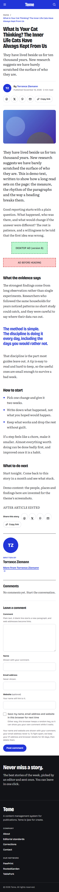
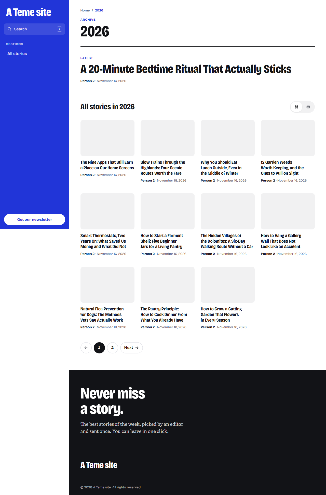
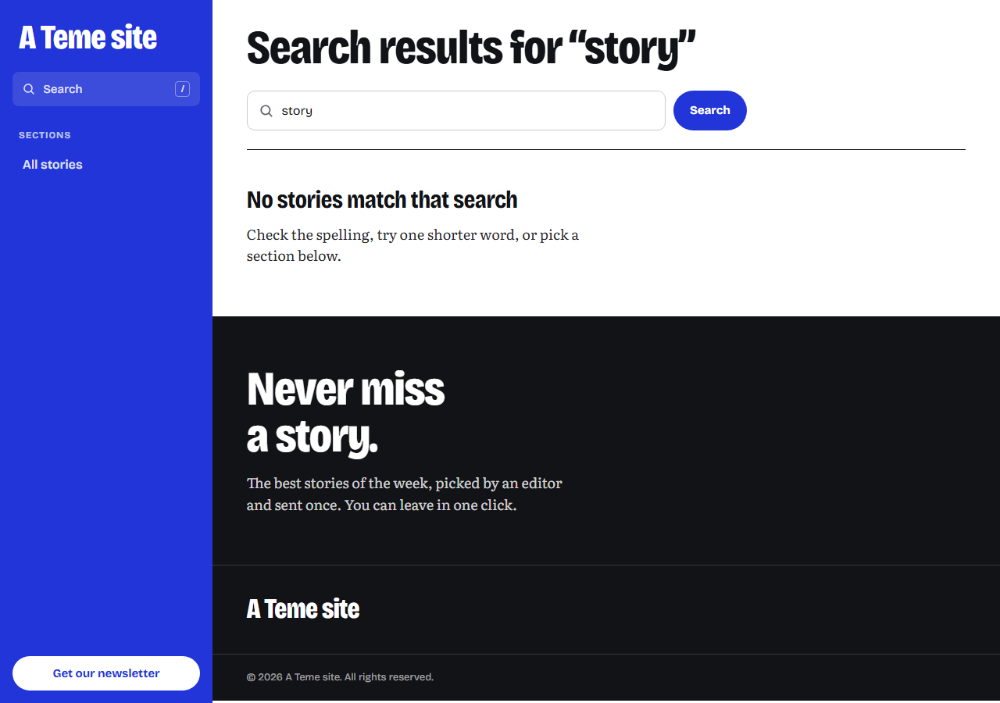
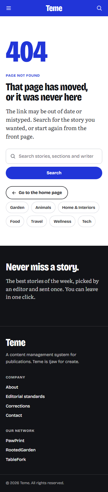

# REPORT: Egberipiribo for Teme

`krafty-sprouts/egberipiribo`, theme code `egberipiribo`, version 0.1.0, by Krafty Sprouts Media, LLC. The shared foundation and one
skin, **Fable**, built from its nine drawings. The Strata and Threads skins and the other demo skins are listed in `FEATURES.md` as
"later".

## Status in one paragraph

The theme is built, committed (13 commits, nothing pushed) and passes `php artisan teme:theme:check egberipiribo` and its own 19
tests. An axe-core, overflow and one-`h1` audit passes on six pages at 1280 and 375 pixels. **It has not been run live on the shared
dev site**: the temecms.com theme session had that site's active theme and asked me not to switch it, so the audit and screenshots
below come from pages the test kit rendered, and the demo content on the dev site has never been drawn by this theme. How to switch it
on is at the end.

## What works

- **Every Fable page**: home (the `latest` kind), article, page, archive (categories, tags, dates), author, search, 404, other errors, and the three core pages for comments
  (a later page of a thread, the reply page, the password page). Each is a skin template that Teme's own template names include in one line, so a
  later skin is one more folder.
- **The rail and chrome**: wordmark and tagline, the one nav from the `primary` menu with openable topics, search panel (a plain GET form, `/` opens it),
  small-screen header and menu, back to top, newsletter band (a region, hidden while empty), footer menus, social icons chosen from each item's address.
- **Design**: the drawings' CSS, ported once. The site's **accent from Settings, Design recolours the rail, kickers, links, buttons and page numbers**
  (Fable's brand colour is the manifest's `accent`). Fonts (Bricolage Grotesque, Literata) are self-hosted from Fontsource through the Vite build, with
  six `woff2` files listed in the manifest; icons are 19 inline SVGs; nothing loads from Google or a CDN.
- **Content**: the cover story, pinned stories, feed with real pagination and a grid/list toggle, breadcrumb, byline, share row, reading bar, in-body contents list in the rail,
  author cards, tags, related stories, comments with core's form, search with core's snippets.
- **Ads**: six regions named for their place (header banner, in-feed banner, most-read side ad, two in-article, article side column), each allowing only the
  Custom HTML card, each drawing nothing while empty. No ad code, network script or placeholder in the theme.
- **Regions an editor fills**: after the article, newsletter, front page "also today", "the long read", "from the sections", "most read".
- **Accessibility**: one `h1` per page, landmarks, skip link (core's), visible focus, no sideways scroll, labels that contain their visible text.
- **Words**: every printed word goes through `__()`; translations for de, es, fr, hi, it, ja, pt_BR (123 sentences each).
- **Structure for later**: each presentational choice is read in one place at the top of its template as `$themeSettings['key'] ?? <default>`;
  `OPTIONS.md` proposes about 55 settings, none built.

## What does not work yet, and why

| What | Why | Where recorded |
|---|---|---|
| Section counts, "Most read" by views, "Quick reads" sort, live search results, section facets | Teme gives a template no counts, views, sort or JSON | FEATURES E3, E6, E17, E19, E39; FINDINGS 20 |
| A newsletter that posts a form | No socket for a theme to post to a service; an editor pastes a provider's embed into the `newsletter` region | FEATURES E10 |
| Categories, authors' portraits and filled regions have only empty-state tests | The public test kit makes a bare post only | FINDINGS 11, 20 |
| A skin switch that also switches tokens | Manifest tokens are static; templates can switch, colours cannot | FINDINGS 1, 6 |
| Numeric and image settings | Teme has four setting types | FINDINGS 7; OPTIONS.md |
| Heading ids and a contents list from core | Core writes `h2` with no id; the template adds ids by parsing the body | FINDINGS 15 |
| Half-page ad only on wide screens | A region is in the page at every width; hidden by CSS only | FINDINGS 21 |
| JavaScript budget | Alpine's CSP build is 24.1 KB compressed against `teme:theme:check`'s 5 KB: a warning, not an error | FINDINGS 17 |
| The icon-pattern option is applied to the front page's long read only, and is off | The drawings' seven main pages are solid; the samples are opt-in | FEATURES E22; OPTIONS.md |
| Dark mode | The drawings have none | FEATURES E45 |

**Not verified**: the page's real content security policy against this theme (Alpine's CSP build ran without errors in a browser with no policy; the
public policy for `data:` images and inline styles is undocumented, finding 19); filled regions, menus, categories and pictures drawn by this theme on a real
site; the demo seed's output as a page.

## Totals

| | |
|---|---|
| Templates Teme chooses (dispatchers) | 12 |
| Fable skin templates | 13 (12 pages and the layout) |
| Fable partials | 26, plus 19 icon views, 1 card override |
| Blade files in all | 71 |
| Stylesheets / scripts | 4 skin CSS files, 1 fonts file, 1 entry; 1 skin script, 1 entry (776 lines of CSS and JS in the skin folders) |
| Built size | CSS 11.1 KB of 15 KB, JS 24.1 KB of 5 KB (compressed) |
| Manifest | 12 regions (6 for ads), 4 menus, 6 fonts, 9 image contexts |
| Tests | 6 files: 19 pass (238 assertions), 1 gated snapshot test skipped by default |
| `teme:theme:check` | passes, 1 warning (JS budget) |
| FEATURES.md rows | 343: 33 same, 132 different, 124 later, 54 can't yet |
| FINDINGS.md | 23 entries (docs missing or wrong, and walls) |
| DECISIONS.md | 28 entries |
| Translations | 7 languages × 123 sentences |
| Commits | 13, nothing pushed |

## Screenshots

In `docs/screenshots/`, taken at 1280 and 375 pixels by `scripts/audit.mjs`. **They are layout-only**: the pages were rendered by the test kit, which
can make bare posts only, so they show no pictures, menus, categories or filled regions (a bare story card is a grey tile). They are not what an owner's
site will look like.

| Page | 1280 | 375 |
|---|---|---|
| Home |  |  |
| Article |  |  |
| Page |  |  |
| Archive |  |  |
| Search |  |  |
| 404 |  |  |

The audit result for those pages is `docs/audit.json`: every page 200 (the kit's response), one `h1`, 0 px sideways overflow, 0 axe violations, 0 console errors.
Author, error and index pages and the three comment pages are covered by their tests but not by screenshots, because the kit cannot reach them with data.

## How to see it on teme-dev

teme-dev already knows the theme: its folder is in `TEME_THEME_PATHS` in `.env` after the temecms theme, and `php artisan teme:themes:link` has linked its `public` folder.

1. **Demo content is already there**: 16 stories (slugs `fable-demo-*`, four pinned), 8 pictures, menus bound to this theme's `primary`, `footer`, `network` and `social` slots,
   and two regions (`home-most-read`, `home-sections`). They show only when this theme is active. `seed/seed.php` is the dev-only script that made them; it uses Teme's own
   Operations (FINDINGS 13). To remove the stories, trash the posts whose address starts `fable-demo-` in the admin.
2. **Activate it** under Site, Themes (check the other sessions using the dev site first: the temecms theme is active now and its owner asked to be told).
   Taking turns on the shared site is by the lock file `teme-plugins/.teme-dev.lock`.
3. **Run the audit on the live site**, from the theme folder:
   ```bash
   node scripts/audit.mjs http://127.0.0.1:8099 home=/ article=/fable-demo-cats/ archive=/?s=garden search=/?s=dog notfound=/nope/
   ```
   It writes screenshots and `docs/audit.json` and exits 1 on any axe violation, overflow or wrong `h1` count.
4. **Tests and check** (from `teme-dev`, needs its PostgreSQL test database; do not run two test runs at once, FINDINGS 12):
   ```bash
   php artisan teme:theme:check egberipiribo
   php artisan test ../teme-themes/egberipiribo/tests --compact
   ```
5. **Rebuild** after changing CSS, JS or the icon list: `npm install`, then `npm run build` (and `npm run icons`).

## Working together

The dev site was shared with the temecms.com theme session and the Securetor port session. We took turns by lock file. I took it for: appending this theme's path to `.env`,
running `teme:themes:link`, and one seeding pass (posts, media, menus, regions). I did not change plugins, migrations, the front page, the posts page, the site name or the
active theme. Nothing was stopped for danger; nothing outside the new folder was deleted or changed, and the WordPress theme was only read.

## For the owner to review

1. `OPTIONS.md`: the settings proposed for Fable, and what each needs.
2. `FINDINGS.md`: items 1, 6, 7, 15 and 17 are the walls that matter most for the next release (tokens and skins, setting types, heading ids, the JS budget).
3. `DECISIONS.md` items 14 to 18 (what replaced the data Teme does not give) and 25 (the seed's use of Teme's internals).
