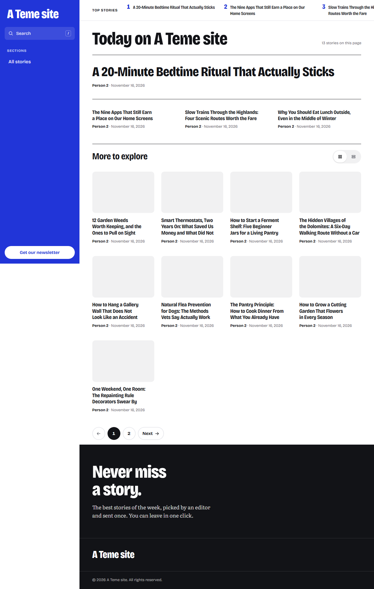
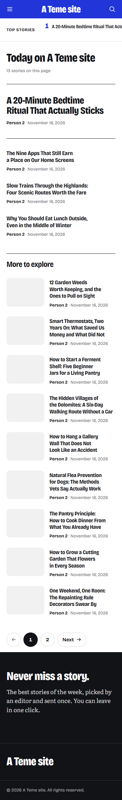
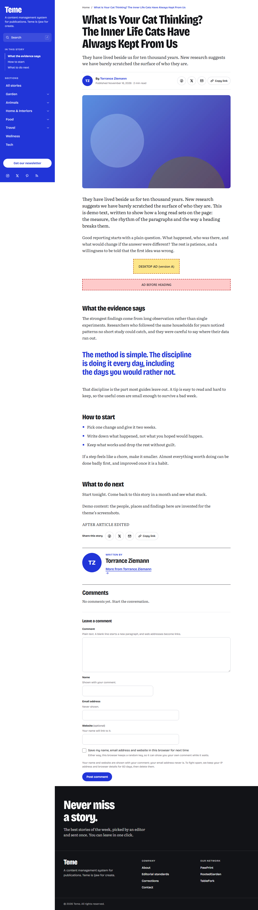
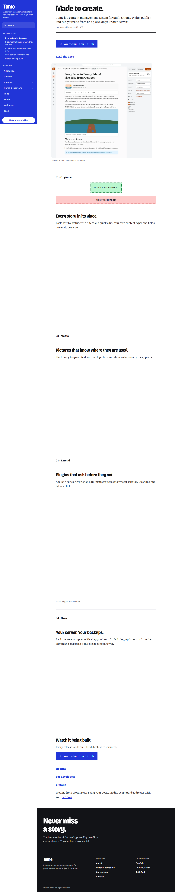
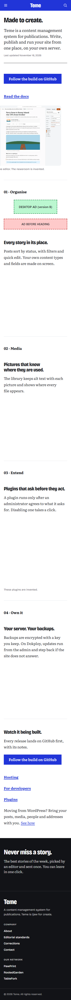
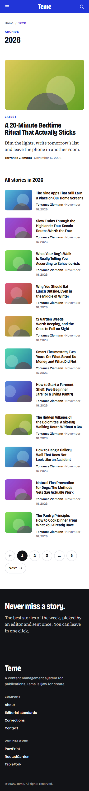
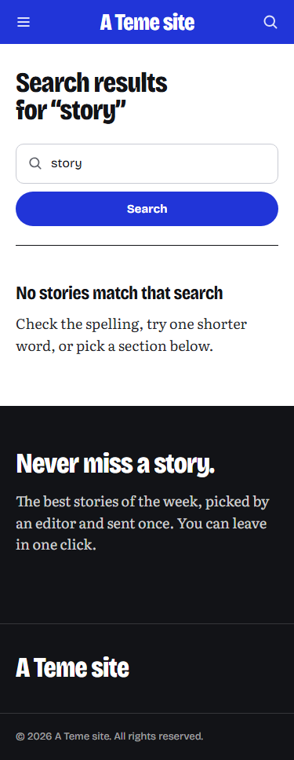
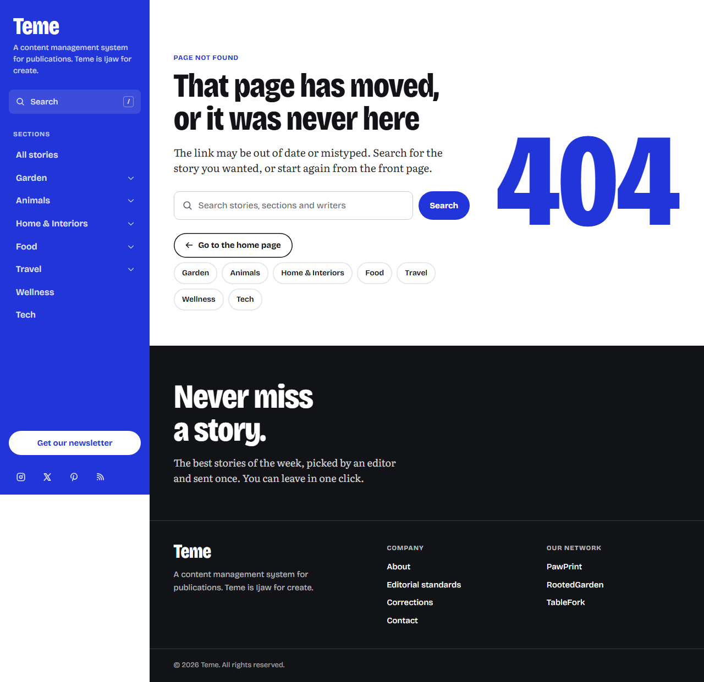

# REPORT: Egberipiribo for Teme

`krafty-sprouts/egberipiribo`, theme code `egberipiribo`, version 0.1.0, by Krafty Sprouts Media, LLC. The shared foundation and one
skin, **Fable**, built from its nine drawings. The Strata and Threads skins and the other demo skins are listed in `FEATURES.md` as
"later".

## Status in one paragraph

The theme is built, committed (nothing pushed) and passes `php artisan teme:theme:check egberipiribo` and its own tests (58 pass, 1 gated snapshot test skipped). It was run
live on the shared dev site, in short turns with the lock after the temecms.com theme session agreed: Fable was made the active theme, audited in a real browser (axe-core, sideways
scroll, one `h1`, console errors) on six pages at 1280 and 375 pixels with the demo content, and then `temecms` was put back and the lock released each time. **All six pages
pass at both widths, with the first 128 settings declared and every default as before.** A second audit of ten pages with settings changed (pattern, share placements and
labels, blocks switched off) passes too, on kit-rendered pages. The site is back on the temecms theme; how to look at Fable again is at the end.

## The first settings (built)

The owner approved building a first set from `OPTIONS.md`: **128 theme settings** (116 switches and selects of `boolean` type, 10 `select`, 1 `text`, 1 `color`), declared in
`teme-theme.json` by `scripts/build-settings.mjs` from `docs/options.json`, each with a "Area: what it controls" label so Settings, Design sorts related ones together:

| Group | Settings |
|---|---|
| The skin and the shared ones (`skin`, ads master, newsletter, updated date, comments, reading time, tags, author card) | 9 |
| Home page blocks (top stories, cover, also today, ads, long read, grid, sections, most read, title, counts) | 20 |
| Article, page and comments blocks | 37 |
| Archive, author, search, 404 and error blocks (and the search panel and its "/" key) | 34 |
| Share: master, ten networks, placement, style, label | 14 |
| Pattern: type, strength, density, accent, colour, layout, style and six "apply to" switches | 13 |
| Footer newsletter band | 1 |

By fieldset: site 35, content 41, latest 20, archive 32. Each is read once at the top of its template; `scripts/check-settings.mjs` proves every declared setting is read and every
template falls back to the manifest default. **Defaults reproduce the drawings**; three moved today's page and are recorded in DECISIONS.md 33: Pinterest share is off (the
drawing has Facebook, X, email and copy), the "updated" rule is one day (Teme's own), and the inline "Related" card (in the drawing, never built) is off.
Not built (still proposals): the 208 other rows in OPTIONS.md, the home-order selects, and everything marked "waits".
**Tests**: each setting has a test that the default renders as before and that switching it changes the page, through `fableSettings()` in `tests/Support/settings.php`, the one
place tests call Teme's own Operations (the public kit cannot set a theme setting: FINDINGS 25). Blocks a bare kit post cannot produce are listed in each test file's header;
their switches are proven by the read and the rendered partial, not by a full page.
**Not verified**: that Settings, Design lists and saves them (it needs an administrator sign-in); the pattern under a strict page policy (it is an inline style attribute, which
fails safe); filled regions with a setting changed.

## What works

- **Every Fable page**: home (the `latest` kind), article, page, archive (categories, tags, dates), author, search, 404, other errors, and the three core pages for comments
  (a later page of a thread, the reply page, the password page). Each is a skin template that Teme's own template names include in one line, so a
  later skin is one more folder.
- **The rail and chrome**: wordmark and tagline, the one nav from the `primary` menu with openable topics, search panel (a plain GET form, `/` opens it),
  small-screen header and menu, back to top, newsletter band (a region, hidden while empty), footer menus, social icons chosen from each item's address.
- **Design**: the drawings' CSS, ported once. The site's **accent from Settings, Design recolours the rail, kickers, links, buttons and page numbers**
  (Fable's brand colour is the manifest's `accent`). Fonts (Bricolage Grotesque, Literata) are self-hosted from Fontsource through the Vite build, with
  six `woff2` files listed in the manifest; icons are 19 inline SVGs; nothing loads from Google or a CDN.
- **Content**: the cover story, pinned stories, feed with real pagination and a grid/list toggle, breadcrumb, byline, share row, reading bar, in-body contents list in the rail,
  author cards, tags, related stories, comments with core's form, search with core's snippets.
- **Ads**: six regions named for their place (header banner, in-feed banner, most-read side ad, two in-article, article side column), each allowing only the
  Custom HTML card, each drawing nothing while empty. No ad code, network script or placeholder in the theme.
- **Regions an editor fills**: after the article, newsletter, front page "also today", "the long read", "from the sections", "most read".
- **Accessibility**: one `h1` per page, landmarks, skip link (core's), visible focus, no sideways scroll, labels that contain their visible text.
- **Words**: every printed word goes through `__()`; translations for de, es, fr, hi, it, ja, pt_BR (123 sentences each).
- **Structure for later**: each presentational choice is read in one place at the top of its template as `$themeSettings['key'] ?? <default>`;
  `OPTIONS.md` lists 336 settings per skin (Fable 222, shared 9 plus the `skin` choice, Strata 47 and Threads 57 for later); **128 are built** (see above), 158 remain proposals and 50 wait on a Teme feature.

## What does not work yet, and why

| What | Why | Where recorded |
|---|---|---|
| Section counts, "Most read" by views, "Quick reads" sort, live search results, section facets | Teme gives a template no counts, views, sort or JSON | FEATURES E3, E6, E17, E19, E39; FINDINGS 20 |
| A newsletter that posts a form | No socket for a theme to post to a service; an editor pastes a provider's embed into the `newsletter` region | FEATURES E10 |
| Categories, authors' portraits and filled regions have only empty-state tests | The public test kit makes a bare post only | FINDINGS 11, 20 |
| A skin switch that also switches tokens | Manifest tokens are static; templates can switch, colours cannot | FINDINGS 1, 6 |
| Numeric and image settings | Teme has four setting types | FINDINGS 7; OPTIONS.md |
| Heading ids and a contents list from core | Core writes `h2` with no id; the template adds ids by parsing the body | FINDINGS 15 |
| Half-page ad only on wide screens | A region is in the page at every width; hidden by CSS only | FINDINGS 21 |
| JavaScript budget | Alpine's CSP build is 24.1 KB compressed against `teme:theme:check`'s 5 KB: a warning, not an error | FINDINGS 17 |
| The icon-pattern option is applied to the front page's long read only, and is off | The drawings' seven main pages are solid; the samples are opt-in | FEATURES E22; OPTIONS.md |
| Dark mode | The drawings have none | FEATURES E45 |

**Verified live** (Fable active on teme-dev, real page headers, no console errors): Alpine's CSP build runs under Teme's page policy, fonts and the build load from
`/themes/egberipiribo/`, menus, pictures, pinned stories, the `home-sections` and `home-most-read` regions, pagination and the rail all draw.
**Not verified**: the icon pattern option (off by default; the policy for `data:` images and inline styles is undocumented, finding 19); the ad, newsletter,
long-read and also-today regions filled with content (the live site had none of them filled); categories, authors' portraits and comments (the demo site has no
categories, and the kit and seed cannot make portraits or comments); the author, error and index pages and the three comment pages on a live site.

## Totals

| | |
|---|---|
| Templates Teme chooses (dispatchers) | 12 |
| Fable skin templates | 13 (12 pages and the layout) |
| Fable partials | 26, plus 19 icon views, 1 card override |
| Blade files in all | 71 |
| Stylesheets / scripts | 4 skin CSS files, 1 fonts file, 1 entry; 1 skin script, 1 entry (776 lines of CSS and JS in the skin folders) |
| Built size | CSS 11.8 KB of 15 KB, JS 24.2 KB of 5 KB (compressed) |
| Manifest | 12 regions (6 for ads), 4 menus, 6 fonts, 9 image contexts, **128 settings** |
| Tests | 13 files: 58 pass (1,456 assertions), 1 gated snapshot test skipped by default |
| `teme:theme:check` | passes, 1 warning (JS budget) |
| FEATURES.md rows | 343: 33 same, 132 different, 124 later, 54 can't yet |
| FINDINGS.md | 24 entries (docs missing or wrong, and walls) |
| DECISIONS.md | 36 entries |
| Translations | 7 languages × 123 sentences |
| Commits | 31, nothing pushed |

## Screenshots

In `docs/screenshots/`, taken at 1280 and 375 pixels by `scripts/audit.mjs` **on the live dev site** with Fable active and the seeded demo content (pictures are generated colour fields,
not photographs); the six default pages are the live ones. The site's name, tagline and the static page's words belong to the temecms theme's site ("Teme", "Made to create."): this theme
drew them. Home is the posts page `/blog/`, because the site's front page is a static page; the "Page" row is that static page. Screenshots named `v-*` show a setting changed (pattern on,
floating or labelled share, blocks switched off) and come from kit-rendered pages with bare posts: they show layout and what the setting does, not a filled-in site.

| Page | 1280 | 375 |
|---|---|---|
| Home |  |  |
| Article |  |  |
| Page |  |  |
| Archive |  |  |
| Search |  |  |
| 404 |  |  |

The audit results are `docs/audit.json` (live, defaults) and `docs/audit-variants.json` (ten pages with settings changed): every page one `h1`, 0 px sideways overflow, 0 axe violations (the 404 page's one console line is the browser noting the 404 status). Author, error and index pages and the three comment pages are covered by their tests but not by screenshots, because the demo site has no authors with pages or comments. The snapshot tooling (`scripts/serve-snapshots.mjs`, `tests/SnapshotTest.php`) remains for when the shared site is busy.

## How to see it on teme-dev

teme-dev already knows the theme: its folder is in `TEME_THEME_PATHS` in `.env` after the temecms theme, and `php artisan teme:themes:link` has linked its `public` folder.

1. **Demo content is already there**: 16 stories (slugs `fable-demo-*`, four pinned), 8 pictures, menus bound to this theme's `primary`, `footer`, `network` and `social` slots,
   and two regions (`home-most-read`, `home-sections`). They show only when this theme is active. `seed/seed.php` is the dev-only script that made them; it uses Teme's own
   Operations (FINDINGS 13). To remove the stories, trash the posts whose address starts `fable-demo-` in the admin.
2. **Activate it** under Site, Themes, or `php ../teme-themes/egberipiribo/seed/seed.php activate` from `teme-dev` (it acts as the site's administrator;
   `restore <code>` puts another theme back). **The temecms theme is active now**, and the temecms.com session's home page and `/blog/` are the site's front and posts
   pages: check with that session first and take the lock file `teme-plugins/.teme-dev.lock`; Fable draws them too. Do not change the front or posts page for a look.
3. **Run the audit on the live site**, from the theme folder:
   ```bash
   node scripts/audit.mjs http://127.0.0.1:8099 home=/blog/ article=/fable-demo-cats/ page=/ archive=/2026/ search="/?s=dog" notfound=/nope/
   ```
   It writes screenshots and `docs/audit.json` and exits 1 on any axe violation, overflow or wrong `h1` count.
4. **Tests and check** (from `teme-dev`, needs its PostgreSQL test database; do not run two test runs at once, FINDINGS 12):
   ```bash
   php artisan teme:theme:check egberipiribo
   php artisan test ../teme-themes/egberipiribo/tests --compact
   ```
5. **Rebuild** after changing CSS, JS or the icon list: `npm install`, then `npm run build` (and `npm run icons`).

## Working together

The dev site was shared with the temecms.com theme session and the Securetor port session. We took turns by lock file. I took it for: appending this theme's path to `.env`,
running `teme:themes:link`, and one seeding pass (posts, media, menus, regions). I did not change plugins, migrations, the front page, the posts page, the site name or the
active theme. Nothing was stopped for danger; nothing outside the new folder was deleted or changed, and the WordPress theme was only read.

## For the owner to review

1. `OPTIONS.md` (rewritten after the owner found the first version too thin): 336 settings per skin and per template, 50 of them waiting on a Teme feature. It is generated from `docs/options.json` by `scripts/build-options.mjs`, which also checks every row against Teme's rules; to adopt or drop a setting, edit the JSON and run the script.
2. `FINDINGS.md`: items 1, 6, 7, 15 and 17 are the walls that matter most for the next release (tokens and skins, setting types, heading ids, the JS budget).
3. `DECISIONS.md` items 14 to 18 (what replaced the data Teme does not give) and 25 (the seed's use of Teme's internals).
